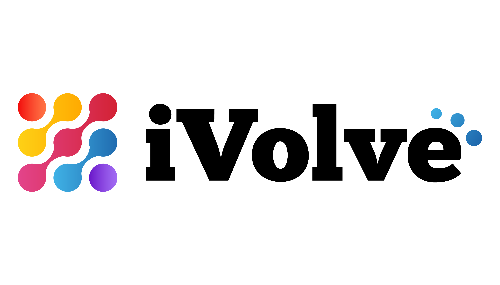

<p align="center">
  
  &nbsp;&nbsp;&nbsp;
  
</p>

<h1 align="center">iVolve Microservices App</h1>

<p align="center">
  Final project for the DevOps training at the National Telecommunication Institute (NTI),
  in collaboration with iVolve Technologies.<br/>
  Three microservices + MySQL, containerized and orchestrated with Docker Compose.
</p>

---

## Contents

- [What the app does](#what-the-app-does)
- [Architecture](#architecture)
- [Services](#services)
- [Tech stack](#tech-stack)
- [Repository layout](#repository-layout)
- [Quick start](#quick-start)
- [Opening the app in a browser](#opening-the-app-in-a-browser)
- [Environment variables](#environment-variables)
- [HTTP endpoints](#http-endpoints)
- [Database](#database)
- [Docker images](#docker-images)
- [Make targets](#make-targets)
- [Troubleshooting](#troubleshooting)
- [Next steps](#next-steps)

---

## What the app does

1. A visitor lands on the authentication page and either **signs up** or **logs in**.
2. The frontend forwards the credentials to the **auth-service**, which hashes/checks them
   against **MySQL** and returns the result.
3. On success the frontend stores the user in a session cookie and redirects to
   `/roadmap`, which renders the DevOps roadmap served by the **roadmap-service**.

The point of the project is not the app itself — it is the delivery stack around it
(images, layers, health checks, networks, volumes) and everything added on top of it
later (CI, Kubernetes, infrastructure as code, GitOps).

---

## Architecture

```text
                       ┌───────────────────────┐
        HTTP :3000     │      Browser          │
   ┌──────────────────►└───────────────────────┘
   │
   │  ┌──────────────────────────────────────────────────────┐
   │  │              Docker network: ivolve-net               │
   │  │                                                      │
   │  │  ┌──────────────────┐                                │
   └──┼─►│ frontend         │  Node 22 / Express / EJS       │
      │  │ :3000            │                                │
      │  └───┬──────────┬───┘                                │
      │      │          │                                    │
      │      │ :5000    │ :8080                              │
      │      ▼          ▼                                    │
      │  ┌────────────┐ ┌──────────────────┐                 │
      │  │ auth-      │ │ roadmap-service  │                 │
      │  │ service    │ │ Java 21 / Spring │                 │
      │  │ Py/Flask   │ │ :8080            │                 │
      │  └─────┬──────┘ └──────────────────┘                 │
      │        │ :3306                                       │
      │        ▼                                             │
      │  ┌────────────┐                                      │
      │  │   MySQL    │  database: ivolve                    │
      │  │   8.0      │  volume:   mysql-data                │
      │  └────────────┘                                      │
      └──────────────────────────────────────────────────────┘

Only port 3000 is published to the host. Everything else is reachable
only from inside the compose network.
```

The frontend is the only entry point: it never talks to MySQL directly, and the
browser never talks to the backend services directly.

---

## Services

| Service | Language / framework | Port | Depends on | Responsibility |
|---|---|---|---|---|
| **frontend** | Node.js 22, Express 5, EJS | 3000 | auth-service, roadmap-service | UI, sessions, calls the two backends |
| **auth-service** | Python 3.12, Flask 3.1 | 5000 | MySQL | Signup / login, bcrypt hashing, `users` table |
| **roadmap-service** | Java 21, Spring Boot 3.5 | 8080 | — | Returns the DevOps roadmap as JSON |
| **mysql** | MySQL 8.0 (official image) | 3306 | — | Persists users in the `ivolve` database |

---

## Tech stack

| Layer | Tools |
|---|---|
| Frontend | Node.js, Express, EJS, express-session, axios |
| Backends | Python / Flask / bcrypt / mysql-connector-python · Java / Spring Boot / Maven |
| Data | MySQL 8.0 |
| Containers | Docker (multi-stage builds, non-root users, health checks), Docker Compose v2 |
| Tooling | GNU Make (shortcut commands), `.env` for local configuration |

---

## Repository layout

```text
.
├── docker-compose.yml          # the whole stack: 4 services, 1 network, 1 volume
├── Makefile                    # make up / down / logs / ps / rebuild / reset / health
├── .env.example                # copy to .env; real .env is git-ignored
├── .gitignore
│
├── frontend/
│   ├── Dockerfile              # node:22-alpine, npm ci, runs as `node`
│   ├── .dockerignore
│   ├── package.json / package-lock.json
│   ├── server.js               # routes: /, /signup, /login, /roadmap, /logout
│   ├── views/                  # auth.ejs, roadmap.ejs, error.ejs
│   └── public/                 # css + logos
│
├── auth-service/
│   ├── Dockerfile              # python:3.12-slim, runs as `appuser`
│   ├── requirements.txt
│   └── app.py                  # /health, /api/auth/signup, /api/auth/login
│
└── roadmap-service/
    ├── Dockerfile              # multi-stage: maven build → eclipse-temurin JRE
    ├── pom.xml
    └── src/main/
        ├── java/com/ivolve/roadmap/  # RoadmapApplication, RoadmapController
        └── resources/application.properties
```

---

## Quick start

**Prerequisites:** Docker Engine 23+ with the Compose v2 plugin (`docker compose version`),
plus `make` and `curl`. On Windows, run everything inside WSL2 (Ubuntu).

```bash
# 1. clone
git clone https://github.com/rowida2/CloudDevOpsProject.git
cd CloudDevOpsProject

# 2. optional: local settings (passwords, port). Defaults work out of the box.
cp .env.example .env

# 3. build images and start everything in the background
make up                       # = docker compose up -d --build

# 4. check the containers (mysql, auth-service and roadmap-service must report "healthy")
make ps
make health
```

Then open the app — see the next section.

Cold start takes a while on the first run because MySQL has to initialise its data
directory (`start_period` for the MySQL health check is 60s on purpose).

---

## Opening the app in a browser

```text
http://localhost:3000
```

If you run Docker Engine **inside WSL2 on Windows 10**, `localhost:3000` is not always
forwarded to Windows. Use the WSL IP instead:

```bash
wsl hostname -I          # e.g. 172.28.115.146
# then open: http://172.28.115.146:3000
```

The container port never changes; only the host address does.

---

## Environment variables

Everything has a working default, so no `.env` is required for a local demo.
Change them in `.env` (never commit it).

| Variable | Used by | Default | Purpose |
|---|---|---|---|
| `FRONTEND_PORT` | docker compose | `3000` | Host port published by the frontend |
| `SESSION_SECRET` | frontend | `dev-session-secret-change-me` | Signs the session cookie |
| `MYSQL_DATABASE` | mysql, auth-service | `ivolve` | Database name |
| `MYSQL_USER` | mysql, auth-service | `ibrahim` | Application DB user |
| `MYSQL_PASSWORD` | mysql, auth-service | `pass@123` | Application DB password |
| `MYSQL_ROOT_PASSWORD` | mysql | `rootpass` | MySQL root password |
| `AUTH_SERVICE_URL` | frontend | `http://auth-service:5000` | Set in compose, internal DNS name |
| `ROADMAP_SERVICE_URL` | frontend | `http://roadmap-service:8080` | Set in compose, internal DNS name |

The auth-service reads **`DB_USER`** (not `DB_USERNAME`) — it maps it to MySQL's
`MYSQL_USER`. Both are wired together inside `docker-compose.yml`.

---

## HTTP endpoints

### frontend (`:3000`) — HTML pages

| Method | Path | Description |
|---|---|---|
| GET | `/` | Login page (redirects to `/roadmap` if already logged in) |
| GET | `/signup` | Signup page |
| POST | `/signup` | Form post → calls auth-service → redirect |
| POST | `/login` | Form post → calls auth-service → session + redirect |
| GET | `/roadmap` | Roadmap page (requires session) |
| POST | `/logout` | Destroys the session |

### auth-service (`:5000`) — JSON API, internal only

| Method | Path | Description |
|---|---|---|
| GET | `/health` | `200 {"status":"UP","database":"connected"}` or `503` |
| POST | `/api/auth/signup` | Body `{"username","password"}` → `201`, `400`, `409`, `503` |
| POST | `/api/auth/login` | Body `{"username","password"}` → `200 {user}`, `401`, `503` |

Validation rules: username ≥ 3 characters, password ≥ 8 characters, username unique.

### roadmap-service (`:8080`) — JSON API, internal only

| Method | Path | Description |
|---|---|---|
| GET | `/api/roadmap` | Array of `{title, description}` roadmap sections |

Because only the frontend is published, test an internal service through the container:

```bash
docker compose exec auth-service python -c \
  "import urllib.request;print(urllib.request.urlopen('http://127.0.0.1:5000/health').read().decode())"

curl -s http://localhost:3000/ -o /dev/null -w '%{http_code}\n'   # 200
```

End-to-end smoke test (signup → login → roadmap) without a browser:

```bash
curl -s -c cookies.txt -o /dev/null -w 'signup: %{http_code}\n' \
  -d 'username=demo1&password=secret123' http://localhost:3000/signup

curl -s -b cookies.txt -c cookies.txt -o /dev/null -w 'login:  %{http_code}\n' \
  -d 'username=demo1&password=secret123' http://localhost:3000/login

curl -s -b cookies.txt -o /dev/null -w 'roadmap:%{http_code}\n' \
  http://localhost:3000/roadmap
```

---

## Database

* Database: `ivolve`, schema created automatically on first MySQL start.
* Table `users` is created by the auth-service itself (`CREATE TABLE IF NOT EXISTS`):
  `id`, `username` (unique), `password_hash` (bcrypt), `created_at`.
* Data lives in the named volume `mysql-data`. `make down` keeps it, `make reset`
  deletes it (`docker compose down -v`) and starts from an empty database.

---

## Docker images

| Image | Base | Size (local build) | Runs as |
|---|---|---|---|
| `ivolve-frontend` | `node:22-alpine` | ~260 MB | `node` (UID 1000) |
| `ivolve-auth-service` | `python:3.12-slim` | ~318 MB | `appuser` (UID 10001) |
| `ivolve-roadmap-service` | `eclipse-temurin:21-jre` | ~497 MB | `appuser` (UID 10001) |
| `mysql` | `mysql:8.0` (official) | ~1.1 GB | `mysql` |

Design decisions in the three Dockerfiles:

* **Dependency layer first.** `package.json` + `package-lock.json` / `requirements.txt` /
  `pom.xml` are copied before the source code, so editing application code does not
  re-download dependencies (the roadmap image build went from ~76s to ~35s).
* **`npm ci` instead of `npm install`.** Uses the lock file → reproducible builds.
* **Multi-stage for Java.** Maven + JDK only exist in the build stage; the runtime image
  contains a JRE and the jar, not the toolchain.
* **Non-root users.** A compromised process gets `node`/`appuser`, not root.
* **Exec-form `CMD`/`ENTRYPOINT`.** The app binary is PID 1, so it receives `SIGTERM`
  and `docker stop` is immediate instead of waiting for the 10s kill timeout.
* **Health checks** in `docker-compose.yml` (`mysqladmin ping`, auth `/health`, roadmap
  `/api/roadmap`). `auth-service` starts only when MySQL is `service_healthy`; the
  frontend starts after the two backends are up, so it never renders a MySQL error page
  just because the database was still initialising.

Rebuild a single image:

```bash
docker compose build frontend
```

---

## Make targets

| Command | What it does |
|---|---|
| `make help` | List the shortcuts |
| `make up` | Build (if needed) and start the stack |
| `make down` | Stop containers, keep the database volume |
| `make logs` | Follow logs of all services |
| `make ps` | Container status + health |
| `make rebuild` | Rebuild images with `--no-cache` and start |
| `make reset` | Destroy everything **including the database volume**, then start clean |
| `make health` | Call the health endpoint of every service |

---

## Troubleshooting

| Symptom | Cause / fix |
|---|---|
| `http://localhost:3000` does not open on Windows | WSL2 port forwarding; use `http://$(wsl hostname -I \| awk '{print $1}'):3000` |
| Frontend returns 503 with a MySQL error page | MySQL is not ready yet or the credentials in `.env` changed. `make ps`, then `make logs` |
| `port is already allocated` | Something else uses 3000: set `FRONTEND_PORT=3001` in `.env` |
| First start looks stuck for a minute | MySQL initialises `/var/lib/mysql`; the health check waits up to 60s |
| Login fails after changing `.env` passwords | The volume still holds the old users. `make reset` (destroys data) |
| Containers keep restarting | `docker compose logs <service>` — usually a missing/invalid env var |

---

## Next steps

The application layer is done; the delivery layer is built on top of it, session by session:

1. **CI** — Jenkins builds the three images, scans them, tags them with the commit SHA.
2. **Registry** — images pushed to a container registry instead of being built locally.
3. **Kubernetes** — Deployments/Services for the three apps, MySQL as a StatefulSet with a PVC,
   ConfigMaps/Secrets, an Ingress in front of the frontend.
4. **Infrastructure as Code** — network, compute and cluster provisioned from code.
5. **GitOps** — cluster state reconciled from Git instead of manual `kubectl apply`.

Each step will be added to this repository as it is completed.
